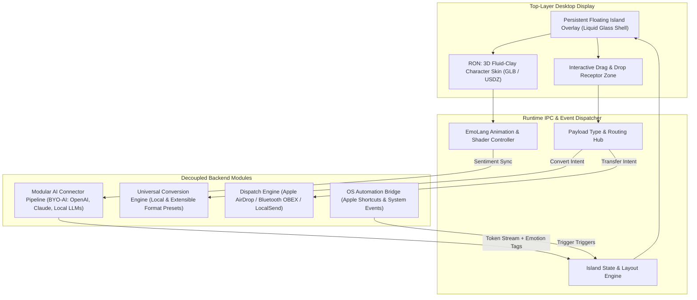

# ADR-0001: Architecture of the Interactive Floating Island Overlay with Decoupled 3D Character Skin ("B-Bot") and Modular Utility Pipeline

## Status
**Accepted** — 2026-11-06

## Context & Problem Statement
Modern desktop workflows require users to frequently switch contexts between AI chat interfaces, system-level file sharing utilities (AirDrop/Bluetooth), and file conversion tools. Existing AI assistants remain trapped in web browser tabs, Electron chat sidebars, or headless CLI terminals without a persistent, embodied spatial presence in the user's digital workspace.

Furthermore, existing conversational avatars tightly couple their visual representation with proprietary, hardcoded LLM backends, preventing users from bringing their own API keys, local models, or custom agent frameworks.

We need an always-accessible, top-layer desktop anchor ("Floating Island") that serves as:
1. An embodied **3D "Character OS" Skin (B-Bot / RON)** that brings any AI assistant to life using expressive fluid-clay shaders and emotional animation scripts (EmoLang).
2. A **Decoupled AI API Gateway** allowing users to bring their own intelligence providers (OpenAI, Anthropic, Ollama, custom endpoints).
3. A tactile **Drag-and-Drop Utility Hub** supporting direct target dispatch (AirDrop/Bluetooth to contacts and macOS/PC endpoints) and universal on-the-fly file conversion.

### Driving Forces & Constraints
- **Spatial Presence vs. Minimal Distraction**: Must float persistently on the top screen layer without blocking critical OS UI (such as menu bars or window controls) and support transparent click-through when idle.
- **BYO-AI (Bring Your Own AI)**: Must decouple the visual avatar frontend from the backend model provider, supporting dynamic model swapping and local privacy.
- **Real-Time 3D Rendering Performance**: Rendering a tactile fluid-clay 3D character with liquid glass shaders must not drain battery or saturate the GPU during long desktop sessions.
- **Cross-Device File Dispatch**: macOS AirDrop integration alongside Bluetooth RFCOMM/OBEX fallbacks for cross-platform PC endpoints.
- **Asset Pipeline Agility**: Missing GLB/USDZ asset formats and Apple Shortcut hooks must be bridged via standardized schemas.

---

## Decision

We have decided to architect the application as a **Decoupled Embodied Overlay System** composed of five modular subsystems:



### 1. Top-Layer Floating Island Shell
- Built using a lightweight native desktop runtime (Metal-accelerated Swift on macOS / DirectComposition on Windows or Tauri with native window handles) with transparent, borderless, always-on-top window attributes.
- Implements dynamic mouse hit-testing: clicks pass through transparent regions when the island is idling, but engage on-hover or during active file dragging.
- Adapts between three dynamic visual states:
  - **Ambient/Idle**: Compact pill showing RON in resting fluid animation.
  - **Utility/Drop Target**: Expanded landing pad when files hover near the top screen edge.
  - **Interactive Workspace**: Dialogue balloon and selector dial for conversions or AI conversations.

### 2. Decoupled "Bring Your Own AI" (BYO-AI) Connector Subsystem
- The 3D Skin (RON) and the AI intelligence engine are strictly decoupled via a standard adapter contract (`IAIConnector`):
  ```typescript
  interface IAIConnector {
    id: string;
    name: string;
    streamMessage(prompt: PromptPayload): AsyncIterable<StreamChunk>;
    supportedModalities: ('text' | 'image' | 'audio' | 'file')[];
  }

  interface StreamChunk {
    textDelta?: string;
    emotionTag?: 'neutral' | 'curious' | 'joy' | 'processing' | 'alert';
    actionTrigger?: ShortcutAction;
  }
  ```
- Supports hot-swapping connectors (Anthropic Claude, OpenAI GPT, Ollama/Local GGUF, or enterprise custom endpoints).
- Raw assistant outputs are filtered through an **EmoLang Parser** that extracts emotional cues and triggers real-time morph targets and shader perturbations on RON.

### 3. 3D Fluid-Clay & Liquid Glass Shader Pipeline
- **Dual-Model Strategy**:
  - Primary multi-platform standard: **GLB (glTF 2.0)** with PBR and skeletal/blendshape morph targets for cross-platform consistency.
  - macOS native integration: **USDZ / SceneKit / RealityKit** with Metal Shading Language (MSL) for zero-copy battery efficiency on Apple Silicon.
- **Performance Optimization**: Dynamic frame-rate throttling (drops to 0–1 fps when the island is undisturbed and no animations are active; smoothly ramps to 60/120 fps upon mouse approach or audio/token streaming).

### 4. Drag-and-Drop Dispatch & Universal Conversion Pipeline
- Dropping a file onto the island opens a radial action halo with two immediate paths:
  1. **Airdrop / Bluetooth Dispatch**: Native Apple `NSSharingServicePicker` or Bluetooth OBEX daemon to send directly to pre-configured receiver contacts or devices.
  2. **Universal Format Conversion**: Inspects source MIME type and presents supported target formats (documents, audio, video, images, archives). Conversion is executed via local sandboxed binaries (`ffmpeg`, `vips`, `pandoc`) with zero remote server upload required.

### 5. OS Automation & Apple Shortcuts Integration
- Exposes an internal URI scheme (`island://action/...`) and Apple Shortcuts runner CLI bridge (`/usr/bin/shortcuts run`) allowing the island and RON to trigger desktop macros and respond to system triggers.

---

## Consequences

### What We Gain (+)
- **Vendor Independence**: Users are never locked into one AI vendor. They bring their own models while enjoying an expressive, premium 3D persona.
- **Unified Micro-Task Ergonomics**: Eliminates tool friction by combining file transfer, file transformation, and AI queries into a single persistent screen coordinate.
- **Tactile Spatial UX**: RON's fluid-clay form and EmoLang reactions transform sterile AI text streams into an engaging, embodied desktop companion.
- **Data Privacy & Security**: File conversions and local model interactions run locally on-device without telemetry or forced cloud storage.

### What We Give Up / Trade-offs (-)
- **GPU & Memory Baseline**: Maintaining an ongoing 3D shader context and transparent window incurs higher RAM (estimated 80–180MB) and GPU idle draw than standard menu-bar utilities. Requires aggressive frame-skipping and sleep shaders.
- **Cross-Platform Feature Asymmetry**: AirDrop and Apple Shortcuts are macOS-exclusive. Windows and Linux targets require fallback bridges (e.g., Bluetooth OBEX, LocalSend protocol, Windows Power Automate).
- **Format Converter Footprint**: Bundling universal conversion engines locally increases installer binary size. (Mitigated by downloading format converter toolchains on-demand).
- **Window Management Quirks**: Handling full-screen games, Stage Manager, multi-display setups, and macOS camera notch obstructions requires active display listener logic.

---

## Alternatives Considered & Why Rejected

### Alternative 1: Monolithic Desktop Chat App with Bundled Fixed LLM
- **Description**: Standard Electron chat window with a hardcoded proprietary LLM and embedded 2D avatar.
- **Reason for Rejection**: Fails the BYO-AI vision. Locks users into ongoing recurring subscription costs or fixed model providers, provides no desktop drag-and-drop utility, and lacks physical presence on top of active workspaces.

### Alternative 2: Lightweight System Tray / Menu Bar Icon with 2D Lottie Animations
- **Description**: Confining the bot and features to a macOS status item menu or Windows taskbar tray icon.
- **Reason for Rejection**: Menu bars provide terrible drag-and-drop targets across large or multi-monitor screens. 2D vector animations cannot achieve the fluid-clay depth, refractive liquid-glass aesthetic, or expressive 3D morphing required by the B-Bot specification.

### Alternative 3: Cloud-Delivered Web-App Floating Widget via Browser Extension
- **Description**: A browser-bound floating widget rendering 3D via WebGL in a chrome extension.
- **Reason for Rejection**: Cannot operate across the entire OS (outside the browser), cannot trigger native AirDrop, cannot access local Bluetooth stacks or Apple Shortcuts, and incurs unacceptable latency.

### Alternative 4: Cloud-Based Streaming Avatar (Pixel Streaming / WebRTC)
- **Description**: Rendering the 3D fluid-clay character on remote cloud GPUs and streaming video frames to the island.
- **Reason for Rejection**: Prohibitive infrastructure cost, high network latency for local interactions, dependency on continuous internet connectivity, and severe security concerns with sending local file buffers to remote servers.
