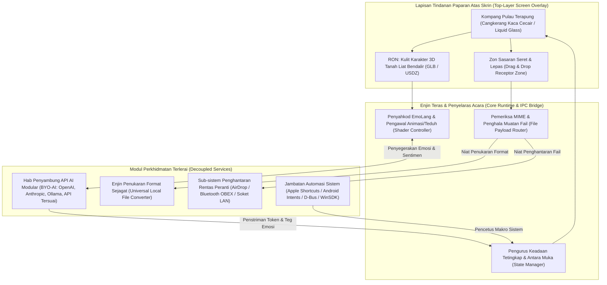

# ADR-0001: Senibina Antara Muka Tindanan Pulau Terapung (Floating Island) dengan Kulit Karakter 3D Terlerai ("B-Bot") dan Saluran Paip Utiliti Rentas Platform

## Status
**Diterima (Accepted)** — 2026-11-06

## Konteks & Pernyataan Masalah (Context & Problem Statement)
Aliran kerja digital moden memaksa pengguna bertukar konteks secara kerap antara pembantu maya AI (yang lazimnya terkurung dalam tab pelayar web atau tetingkap sembang terasing), utiliti penghantaran fail sistem (seperti AirDrop dan Bluetooth), serta perkakasan penukaran format fail pihak ketiga. Model pembantu perbualan semasa ketiadaan kehadiran spatial fizikal yang berterusan di atas ruang kerja skrin (*desktop workspace*).

Selain itu, penyelesaian avatar digital sedia ada mengikat representasi visual 3D secara ketat (*tight coupling*) dengan model bahasa raya (LLM) proprietari tertentu. Ini menghalang pengguna daripada memanfaatkan model kecerdasan buatan pilihan mereka sendiri (*Bring Your Own AI* - BYO-AI), termasuk API luaran mahupun model tempatan berorientasikan privasi.

Bagi merealisasikan produk **B-Bot (The Character OS)** di bawah kategori *Intelligent Interface / Assistant*, satu keputusan senibina diperlukan untuk membina titik sauh desktop atas skrin ("Pulau Terapung" / *Floating Island*) yang interaktif, berprestasi tinggi, dan menyokong ekosistem rentas platform (macOS, Windows, Linux, dan Android Mobile).

### Fasa & Status Semasa Projek
- **Visi Reka Bentuk (*Design Vision*)**: Selesai (*Done*)
- **Skrip Suai Tugas (*Onboarding Script*)**: Selesai (*Done*)
- **Fasa Semasa**: Pembangunan Teduh 3D (*3D Shader Development*)
- **Aset Sedia Ada**: Olok-olok Kaca Cecair (*Liquid Glass Mockups*), Skrip EmoLang, Dialog Suai Tugas Tersuai (*Custom Onboarding Dialogue*).
- **Keperluan & Butiran Kritikal yang Perlu Diselesaikan**:
  1. Spesifikasi integrasi model 3D (saluran paip dwi-format GLB / USDZ).
  2. Integrasi automasi sistem (Apple Shortcuts pada macOS/iOS, serta Android Intents, Windows URI Scheme, dan Linux D-Bus).
  3. Mekanisme pemindahan fail dwiarah (AirDrop dan Bluetooth OBEX / LocalSend) ke kenalan, MacBook, PC Windows, dan peranti Android.
  4. Enjin penukaran fail sejagat (*Universal File Converter*) tempatan berasaskan seret dan lepas (*drag and drop*).

---

## Keputusan Senibina (Decision)

Kami memutuskan untuk mengguna pakai **Senibina Tindanan Terlerai Berbilang Lapisan (*Decoupled Multi-Layered Overlay Architecture*)** yang mengasingkan antara muka visual, enjin pemaparan karakter, dan get laluan modular penyambung AI serta utiliti sistem.



### 1. Kompang Pulau Terapung & Tingkah Laku Spatial (*Floating Island Shell*)
- Dilaksanakan menggunakan rangka kerja natif ringan dengan pecutan GPU perkakasan (Tauri / Rust bersama cangkuk natif tetingkap lutsinar, Metal pada macOS/iOS, DirectComposition pada Windows, dan Wayland/X11 subsurfaces pada Linux).
- Menyokong ujian perlanggaran kursor (*dynamic hit-testing*): lutsinar sepenuhnya terhadap klik tetikus semasa mod melahu (*idle*), dan bertukar menjadi kawasan interaktif aktif apabila kursor menghampiri atau fail diseret ke atasnya.
- Mod visual anjal:
  - **Mod Melahu (*Ambient Idle*)**: Kapsul kaca cecair padat memaparkan RON dalam animasi pernafasan bendalir perlahan.
  - **Mod Penukaran / Pemindahan (*Utility Dropping*)**: Mengembang serta-merta menjadi dok seret-lepas dengan menu radial dwifungsi (Pindah atau Tukar Format).
  - **Mod Karakter Aktif (*Embodied Bot Workspace*)**: Mengembangkan belon dialog cecair dan medan input interaksi AI.

### 2. Modul Penyambung API AI Modular (*BYO-AI Architecture*)
- Memutuskan kebergantungan tegar antara kulit 3D dan model kecerdasan buatan melalui antara muka generik:
  ```typescript
  interface IAIConnectorBridge {
    providerId: string;
    modelIdentifier: string;
    executeStream(payload: InteractionContext): AsyncIterable<StreamPacket>;
    getCapabilities(): ModalitySupport;
  }

  interface StreamPacket {
    deltaText?: string;
    emoToken?: 'melahu' | 'ingin_tahu' | 'kegembiraan' | 'memproses' | 'waspada';
    systemAction?: AutomationCommand;
  }
  ```
- Pengguna boleh mendaftarkan kunci API sendiri (OpenAI GPT-4o, Anthropic Claude 3.5, Google Gemini) atau menghala ke pelayan inferens tempatan tanpa internet (seperti Ollama, llama.cpp, vLLM).
- **Penyahkod EmoLang**: Mentafsir bait data emosi daripada respons AI untuk mengubah parameter teduh bendalir (*fluid viscosity, surface tension, chromatic aberration*) dan sasaran bentuk gabungan (*blendshapes/morph targets*) karakter RON secara masa nyata.

### 3. Saluran Paip Model 3D & Teduh Tanah Liat Bendalir (*Shader Pipeline*)
- **Piawaian Dwi-Model (GLB + USDZ)**:
  - **GLB (glTF 2.0 Binary)**: Format primer bagi keserasian rentas platform sejagat (Windows, Linux, Android, WebGL/WebGPU). Mengandungi jaring poligon dioptimumkan, tekstur PBR mampat, dan penanda bentuk (*morph targets*).
  - **USDZ (Universal Scene Description)**: Format khusus bagi persekitaran Apple (macOS dan iOS) untuk memanfaatkan enjin Metal/RealityKit secara terus tanpa beban penterjemahan.
- **Pengurusan Kitaran Kuasa Rendah**: Pengurangan kadar bingkai dinamik (*dynamic framerate scaling*) — beroperasi pada 0–1 fps semasa tiada interaksi fizikal bagi menjimatkan bateri komputer riba dan peranti mudah alih, dan meningkat lancar ke 60/120 fps sejurus interaksi berlaku.

### 4. Saluran Utiliti Seret & Lepas (AirDrop, Bluetooth, & Penukaran Fail)
- Sejurus fail dilepaskan ke Pulau Terapung, sistem menjalankan pengesanan MIME pantas:
  - **Laluan Penghantaran (*Dispatch Path*)**: Menghubungi kenalan penerima atau peranti terpilih (MacBook, PC, Android) melalui protokol natif:
    - macOS / iOS: Panggilan API natif Apple AirDrop (`NSSharingService`).
    - Windows / Linux / Android: Protokol Bluetooth OBEX, disokong oleh protokol sambungan rangkaian setempat peer-to-peer (*LocalSend / mDNS Wi-Fi Direct*) bagi pemindahan pantas.
  - **Laluan Penukaran Sejagat (*Universal Conversion Path*)**: Memaparkan roda format sasaran berdasarkan jenis fail sumber (imej, video, dokumen, audio, arkib). Penukaran diproses secara setempat menggunakan enjin terbenam termampat (seperti `ffmpeg`, `libvips`, `pandoc`) tanpa memerlukan muat naik ke pelayan awan.

### 5. Integrasi Automasi Rentas Sistem Operasi
- **macOS**: Jambatan terus ke Apple Shortcuts melalui binari `/usr/bin/shortcuts run "Nama Pintasan"` dan AppleScript/JXA.
- **Android Mobile**: Integrasi melalui penyiaran `Intent` eksplisit dan perkhidmatan latar belakang (*Foreground Service*) untuk menampilkan buih terapung (*floating bubble overlay*).
- **Windows**: Pengendali Protokol URI Tersuai (`island://action`) dan penyepaduan Windows App SDK / PowerShell.
- **Linux**: Antara muka D-Bus piawai (*org.freedesktop.Notifications* dan *org.freedesktop.FileManager1*).

---

## Implikasi & Kompromi (Consequences)

### Kelebihan & Keuntungan Senibina (+)
1. **Kebebasan Ekosistem AI Penuh**: Pengguna memiliki autonomi mutlak terhadap enjin kecerdasan pintar pilihan mereka sementara B-Bot bertindak sebagai lapisan kulit visual yang konsisten.
2. **Ergonomik Ruang Kerja Setempat**: Menghapuskan pembaziran masa navigasi antara pelbagai aplikasi dengan menyatukan pemindahan fail, penukaran format, dan sembang AI di satu titik koordinat tetap.
3. **Privasi Data Maksimum**: Tiada fail dokumen atau imej yang dihantar ke pelayan luaran bagi tujuan penukaran format; semuanya diproses pada perkakasan setempat (*on-device execution*).
4. **Ekspresi Visual Unik**: Estetika Kaca Cecair (*Liquid Glass*) dan karakter tanah liat bendalir RON menghidupkan interaksi mesin-manusia secara organik melalui bahasa ekspresi EmoLang.

### Kekurangan, Risiko & Kompromi (-)
1. **Beban Memori & Penggunaan GPU**: Mengekalkan tetingkap tindanan 3D lutsinar memerlukan peruntukan RAM asas (anggaran 90–200 MB) dan kitaran GPU melahu. Memerlukan logik *sleep-state* yang agresif untuk mengelakkan penyusutan bateri.
2. **Kerumitan Protokol Pemindahan Fail**: Ketiadaan sokongan AirDrop rasmi pada Windows/Linux/Android memerlukan penyelenggaraan saluran sandaran dwiprotokol (Bluetooth OBEX dan protokol LAN terbuka).
3. **Saiz Pakej Pemasang**: Penukaran format luar talian memerlukan binari pemprosesan setempat yang boleh membesarkan saiz pemasang (diselesaikan melalui modul pemalam muat turun atas permintaan).
4. **Pengurusan Tetingkap Pelbagai Monitor**: Pengendalian tetingkap tindanan sentiasa di atas (*always-on-top*) terdedah kepada isu pertindihan paparan skrin penuh (*full-screen mode*), takuk kamera (*notch*), dan pengurus tetingkap pelbagai skrin.

---

## Alternatif yang Dipertimbangkan dan Sebab Penolakan

### Alternatif 1: Aplikasi Sembang Desktop Monolitik dengan Model LLM Terbina
* **Penerangan**: Membina aplikasi tetingkap Electron standard yang dibundel bersama satu model LLM komersial tetap dan avatar 2D statik.
* **Sebab Ditolak**: Melanggar teras konsep BYO-AI, mengenakan kos langganan API berterusan kepada pengguna, ketiadaan kehadiran spatial di lapisan atas skrin, serta tiada utiliti seret-lepas fail.

### Alternatif 2: Ikon Bar Menu / Dulang Sistem (*System Tray*) dengan Animasi Vektor Lottie 2D
* **Penerangan**: Mengehadkan fungsi bot dan zon seret-lepas ke dalam ikon bar menu sistem operasi dengan animasi 2D.
* **Sebab Ditolak**: Sukar dijadikan sasaran seret-lepas pada paparan monitor beresolusi tinggi; animasi 2D rata tidak mampu memaparkan kedalaman pembiasan kaca cecair dan sifat fizikal bendalir 3D tanah liat karakter RON.

### Alternatif 3: Widget Web Terapung Menggunakan Sambungan Pelayar (*Browser Extension*)
* **Penerangan**: Membina widget terapung berasaskan WebGL yang disuntik ke dalam laman web pelayar.
* **Sebab Ditolak**: Tidak dapat berfungsi di luar lingkungan pelayar web (tidak mampu berinteraksi dengan aplikasi desktop natif), tiada akses kepada API AirDrop, Bluetooth, atau sistem fail setempat.

### Alternatif 4: Avatar Penstriman Piksel Awan (*Cloud Pixel Streaming / WebRTC*)
* **Penerangan**: Memaparkan grafik 3D tanah liat bendalir pada pelayan awan GPU berprestasi tinggi dan menstrim video interaktif ke komputer pengguna.
* **Sebab Ditolak**: Menjana sela masa (*latency*) yang tidak boleh diterima bagi sebuah antara muka pengguna desktop, kos pelayan GPU yang terlalu tinggi, memerlukan sambungan internet berterusan, dan mencetuskan isu keselamatan siber semasa memproses penimbal fail tempatan.
