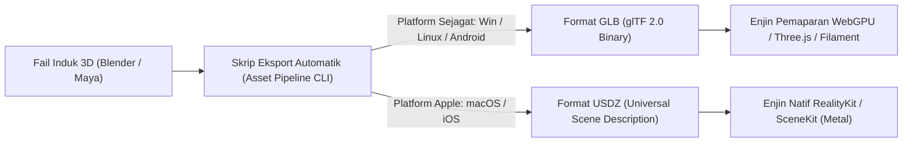

# Spesifikasi Teknikal: Saluran Paip Aset Model 3D & Peneduh Tanah Liat Bendalir (RON)

## 1. Pengenalan
Dokumen spesifikasi ini memperincikan pelaksanaan fizikal dan visual watak **RON (B-Bot / The Character OS)** sebagai kulit (*skin*) ruang kerja digital pada antara muka tindanan Pulau Terapung (*Floating Island*). Spesifikasi ini menangani keperluan dwi-format (**GLB** dan **USDZ**) serta parameter peneduh tanah liat bendalir (*fluid-clay shader*) dan kaca cecair (*liquid glass*).

---

## 2. Struktur Dwi-Format Aset 3D



### 2.1 Format Primer: GLB (glTF 2.0 Binary)
* **Penggunaan**: Windows, Linux, Android Mobile, dan fallback Web/Tauri.
* **Kekangan Geometri**:
  * Had Poligon: Maksimum 25,000 segi tiga (*triangles*) untuk mod perincian tinggi (LOD 0); 8,000 segi tiga untuk mod penjimatan kuasa (LOD 1).
  * Struktur Topologi: Jaring poligon tertutup (*manifold mesh*) dengan topologi seragam bagi mengelakkan herotan semasa interpolasi morf.
* **Sasaran Bentuk Gabungan (*Morph Targets / Blendshapes*)**:
  1. `emo_neutral` (Keadaan melahu lalai)
  2. `emo_curious` (Peregangan kubah atas +20%, kecondongan paksi-Y 15 darjah)
  3. `emo_joy` (Pelebaran horizontal +25%, riak permukaan frekuensi tinggi)
  4. `emo_processing` (Pusaran vorteks dalaman berkelajuan 1.5 rad/s)
  5. `emo_alert` (Pengecutan tegang -15%, gelombang kejutan pinggir)

### 2.2 Format Khusus Apple: USDZ
* **Penggunaan**: macOS (Apple Silicon M-Series) dan iOS.
* **Penyepaduan Natif**:
  * Pematuhan penuh terhadap penspesifikasian RealityKit / MetalKit untuk pemaparan tanpa sela (*zero-copy rendering*).
  * Sokongan penuh perkakasan penyatuan memori (*Unified Memory Architecture*).

---

## 3. Parameter Peneduh Tanah Liat Bendalir (*Fluid-Clay Shader Parameters*)

Peneduh tanah liat bendalir menggabungkan simulasi dinamik bendalir masa nyata dengan sifat serakan bawah permukaan (*Subsurface Scattering - SSS*) bahan tanah liat:

```glsl
// Definisi Pemboleh Ubah Peneduh Serakan Bawah Permukaan (Fragment Shader)
struct FluidClayMaterial {
    vec3 baseAlbedo;          // Warna asas: #E0E7FF (Lilac-Clay)
    vec3 subsurfaceColor;     // Warna serakan: #818CF8
    float subsurfaceRadius;   // Jarak serakan foton: 0.45
    float surfaceRoughness;   // Kekasaran permukaan: 0.28 (kemasan matte licin)
    float fluidViscosity;     // Kelikatan bendalir: 1.8 Pa.s
    float surfaceTension;     // Tegangan permukaan: 0.72 N/m
    float liquidGlassReflect; // Pantulan kaca cecair Fresnel: F0 = 0.04
};
```

---

## 4. Kawalan Kitaran Kuasa Rendah (*Low-Power Adaptive Throttling*)

Bagi mengelakkan penyusutan bateri peranti riba atau telefon pintar Android:
1. **Keadaan Melahu (*Ambient Idle State*)**:
   * Kadar bingkai (*framerate*) dikurangkan kepada **1 fps**.
   * Peneduh bendalir dinyahaktifkan; gelung animasi digantikan dengan tekstur statik terpeta.
2. **Keadaan Menghampiri Kursor (*Proximity Wakeup*)**:
   * Apabila kursor berada dalam radius 120px daripada Pulau Terapung, kadar bingkai dinaikkan serta-merta ke **60 fps** (atau **120 fps** pada paparan ProMotion).
3. **Keadaan Interaksi Berterusan (*Active Session*)**:
   * Peneduh penuh dengan simulasi fizik bendalir diaktifkan pada kiraan 60/120 fps.
