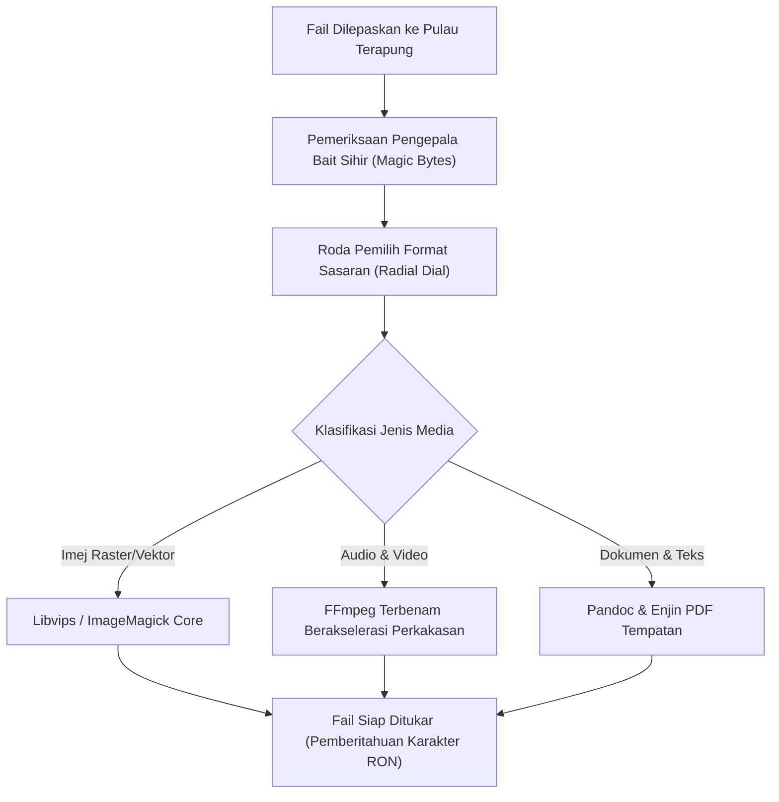

# Spesifikasi Teknikal: Integrasi Automasi Rentas Platform & Pemindahan Fail

## 1. Pengenalan
Dokumen ini menetapkan spesifikasi protokol komunikasi antara proses (IPC), automasi sistem operasi, dan saluran penghantaran fail bagi Pulau Terapung (*Floating Island*) pada macOS, Windows, Linux, dan Android Mobile.

---

## 2. Matriks Integrasi Sistem Operasi

| Sistem Operasi | Enjin Automasi | Protokol Pemindahan Fail | Mekanisme Tindanan (*Overlay*) |
| :--- | :--- | :--- | :--- |
| **macOS** | Apple Shortcuts CLI (`shortcuts run`) & AppleScript | Apple AirDrop Natif (`NSSharingServicePicker`) | Tetingkap NSWindow Tanpa Sempadan + Metal Layer |
| **Android Mobile** | `Intent` Ekosistem & `BroadcastReceiver` | Bluetooth OBEX & Sambungan Wi-Fi Langsung | `WindowManager.LayoutParams.TYPE_APPLICATION_OVERLAY` |
| **Windows** | Skema Protokol URI Tersuai (`island://`) & WinSDK | Bluetooth RFCOMM / OBEX & LocalSend P2P | Windows DirectComposition & Window Cloaking |
| **Linux** | D-Bus (*org.freedesktop*) & Skrip Shell | Bluetooth OBEX (BlueZ) & Soket TCP Tempatan | Wayland Layer Shell Protocol / X11 Compositor |

---

## 3. Spesifikasi Integrasi Apple Shortcuts (macOS & iOS)

Pulau Terapung bertindak sebagai ejen pemula dan penerima tindakan automasi Apple Shortcuts:

```bash
# Pelaksanaan Arahan Melalui Subsistem macOS CLI
/usr/bin/shortcuts run "Ringkaskan Dokumen Semasa" -i "/tmp/island_payload.pdf"
```

### 3.1 Skema URI Tersuai Pulau Terapung (`island://`)
Pulau Terapung mengekspos titik masuk sejagat yang boleh dipanggil daripada Apple Shortcuts atau sebarang klien luaran:
```
island://action/convert?sourceFormat=png&targetFormat=webp&inputPath=/path/to/file.png
island://action/dispatch?targetDevice=MacBookPro&contactId=dev@axisync.work
island://assistant/prompt?query=Analisis%20fail%20ini&model=claude-3-5-sonnet
```

---

## 4. Pelaksanaan Tindanan Android Mobile (*Android Floating Bubble*)

Pada peranti mudah alih Android:
1. **Perkhidmatan Latar Hadapan (*Foreground Service*)**: Menjalankan perkhidmatan berterusan dengan notifikasi berkeutamaan tinggi bagi mengelakkan penamatan oleh pengurus memori OS (OOM Killer).
2. **Kebenaran Tindanan (*Overlay Permission*)**: Memohon `android.permission.SYSTEM_ALERT_WINDOW`.
3. **Penyepaduan `Intent`**: Menerima fail melalui penapis tindakan kongsi Android:
```xml
<intent-filter>
    <action android:name="android.intent.action.SEND" />
    <category android:name="android.intent.category.DEFAULT" />
    <data android:mimeType="*/*" />
</intent-filter>
```

---

## 5. Saluran Paip Penukaran Fail Sejagat Tempatan (*Universal Local Converter*)

Penukaran format fail berlaku secara setempat pada perkakasan tanpa pergantungan awan:


